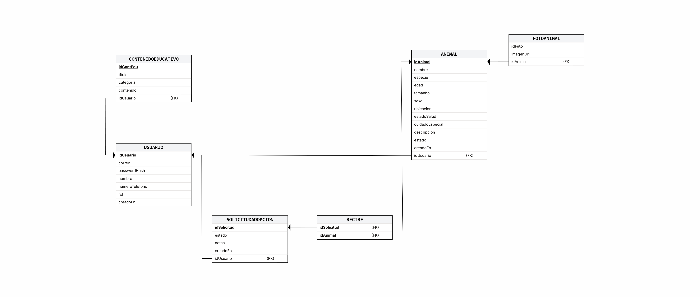

# Huellas-al-Hogar
Plataforma web y móvil orientada a fomentar la adopción y tenencia responsable de animales, entregando información preventiva sobre el abandono, el cuidado animal y las consecuencias de la proliferación de animales callejeros.

# Modelo de base de datos (EP 2.2)
El sistema utiliza una base de datos relacional implementada en PostgreSQL.

### 1. Diagramas de diseño
A continuación se presentan el Modelo Entidad-Relación y el Esquema Relacional del sitio web:

### Modelo Entidad-Relación (MER)


### Esquema Relacional (Modelo Lógico)



### 2. Estructura de Tablas y Relaciones
* **`usuarios`**: Almacena las cuentas registradas con sus credenciales encriptadas (`password_hash`) y sus roles (`ADMIN`, `RESCATISTA`, `ADOPTANTE`).
* **`animales`**: Guarda la información de las mascotas en adopción. Mantiene una relación con la tabla `usuarios` mediante `usuario_id`.
* **`solicitudes_adopcion`**: Entidad asociativa que conecta a un adoptante con un animal para realizar el seguimiento del estado de la adopción (`PENDIENTE`, `APROBADA`, `RECHAZADA`).
* **`contenidos_educativos`**: Publicaciones y artículos informativos creados por usuarios con permisos.

# Configuración e Instalación Local
### 1. Requisitos Previos
* Node.js v18+ 
* PostgreSQL v14+

### 2. Creación de la Base de Datos
Abre PostgreSQL y crea la base de datos:
```bash
CREATE DATABASE huellas_al_hogar;
```
Luego, para crear la estructura completa de la base de datos (tablas, ENUMs y relaciones), ejecuta el script DDL ubicado en la carpeta `database`:

```bash
psql -U tu_usuario -d tu_base_de_datos -f database/schema.sql
```
El comando previo se ejecuta en la terminal. Sirve para interactuar con la base de datos de PostgreSQL desde la línea de comandos. Para que Windows o Mac reconozcan el comando psql directo en la terminal, PostgreSQL debe estar agregado a las variables de entorno (PATH) de tu sistema. 
Si la terminal no reconoce "psql", abre SQL SHELL que se instala automáticamente junto con Postgres en el PC.

### 3. Instalación de dependencias
```bash
npm install
npm run dev
```
Estos comandos se ejecutan dentro de la carpeta del backend (es decir, en la ruta donde se encuentra el archivo package.json). Caso contrario, arrojará error porque no halla qué instalar ni qué ejecutar.
