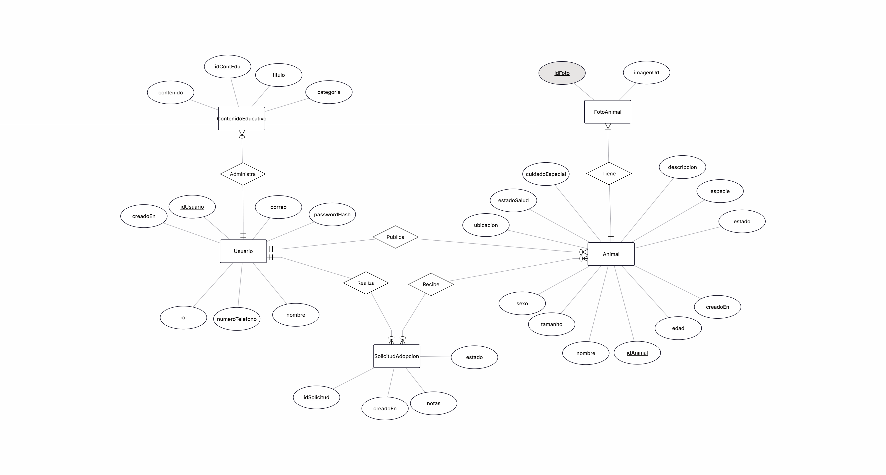
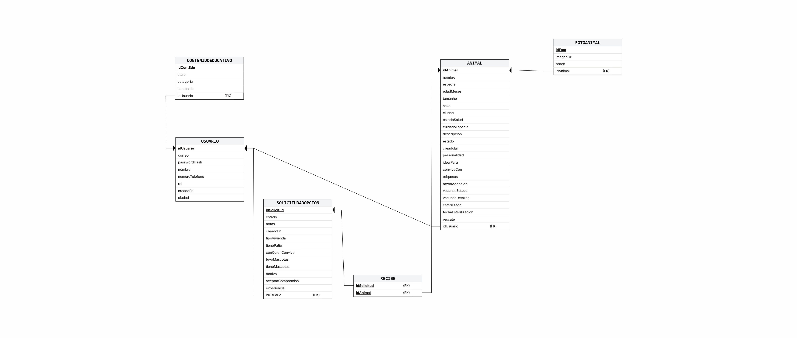

# Huellas-al-Hogar
Plataforma web y móvil orientada a fomentar la adopción y tenencia responsable de animales, entregando información preventiva sobre el abandono, el cuidado animal y las consecuencias de la proliferación de animales callejeros.

# Modelo de base de datos (EP 2.2)
El sistema utiliza una base de datos relacional implementada en PostgreSQL.

### 1. Diagramas de diseño
A continuación se presentan el Modelo Entidad-Relación y el Esquema Relacional del sitio web:

### Modelo Entidad-Relación (MER)


### Esquema Relacional (Modelo Lógico)



### 2. Estructura de Tablas y Relaciones
- **usuarios**: Almacena las cuentas registradas con sus credenciales encriptadas (`password_hash`), sus roles (`ADMIN`, `RESCATISTA`, `ADOPTANTE`) y datos de contacto como la `ciudad`.
- **animales**: Guarda la información detallada de las mascotas en adopción (datos de salud, esterilización, tipo de rescate, rasgos de personalidad, etiquetas de compatibilidad y ciudad). Mantiene una relación con la tabla `usuarios` mediante `usuario_id`.
- **foto_animales**: Almacena la galería de imágenes asociadas a cada mascota (con `imagen_url` y `orden` correlativo para gestionar un límite de hasta 5 fotos por animal). Se relaciona directamente con `animales` a través de `animal_id`.
- **solicitudes_adopcion**: Entidad asociativa que conecta a un adoptante (`usuario_id`) con un animal (`animal_id`). Almacena los datos completos del formulario de postulación (tipo de vivienda, patio, experiencia previa, convivencia y motivo de adopción) y realiza el seguimiento del estado de la solicitud (`PENDIENTE`, `APROBADA`, `RECHAZADA`) junto con notas internas de administración.
- **contenidos_educativos**: Publicaciones y artículos informativos creados por usuarios con permisos (`usuario_id`).

Se configuraron las claves primarias, claves foráneas y restricciones para asegurar la consistencia de los datos entre tablas, como la relación de un animal con sus fotografías o con sus solicitudes de adopción.

Se generó y almacenó el archivo .sql en la rama backend del repositorio, el cual contiene la estructura completa para replicar la base de datos localmente.
# Configuración e Instalación Local
### 1. Requisitos Previos
* Node.js v18+ 
* PostgreSQL v14+

### 2. Creación de la Base de Datos
Abre PostgreSQL y crea la base de datos:
```bash
CREATE DATABASE huellas_al_hogar;
```
Luego, para crear la estructura completa de la base de datos (tablas, ENUMs y relaciones), ejecuta el script DDL ubicado en la carpeta `database`, el que se llama `schema.sql`; lo anterior creará las tablas con sus respectivos atributos.

### 3. Configuración del archivo .env
Este archivo es fundamental para que el backend funcione correctamente. Este archivo tiene la siguiente estructura:
```
PGHOST=localhost
PGPORT=5432
PGDATABASE= (nombre de la base de datos que creaste para ejecutar el script schema.sql)
PGUSER=postgres
PGPASSWORD= (la contraseña que usas para acceder a postgres)
JWT_SECRET=HuellasAlHogar2026_ClaveSuperSecreta_Para_El_Proyecto_Final
JWT_EXPIRES_IN=1h
```
Debes reemplazar los valores de PGDATABASE y PGPASSWORD para que el .env funcione. El JWT_SECRET tiene una validación de 32 caracteres o más, por eso es largo y si no lo fuera, el .env no funcionaría. 


### 3. Instalación de dependencias
```bash
npm install
npm install multer
npm run dev
```
Estos comandos se ejecutan dentro de la carpeta del backend (es decir, en la ruta donde se encuentra el archivo package.json). Caso contrario, arrojará error porque no halla qué instalar ni qué ejecutar.


# Consumo de la API REST desde el frontend (EP 2.4)
En esta fase se integró la interfaz gráfica interactiva con los servicios del servidor para operar con los datos persistentes. Esto se puede evidenciar en los siguientes puntos:
- **Conexión Frontend-Backend**: Se estableció la comunicación asíncrona desde la aplicación desarrollada en Ionic con React hacia los endpoints del servidor Node.js.
- **Peticiones HTTP y Manejo de Errores**: Se configuró el procesamiento de las solicitudes a la API utilizando interceptores, implementando un manejo adecuado de las respuestas y la captura de excepciones.
- **Gestión de Sesiones (JWT)**: Se implementó la administración del Json Web Token (JWT) en el cliente, asegurando su almacenamiento y envío en las peticiones para autorizar el acceso a recursos protegidos.
- **Envío de Datos Complejos (Multipart/FormData)**: Se implementó el empaquetado de datos a través de FormData desde el formulario tipo wizard en React, permitiendo enviar texto y archivos multimedia (imágenes) de forma simultánea hacia el endpoint de publicación.
- **Gestión de Flujos Basada en Roles**: El consumo de la API se vinculó a la protección de rutas del frontend. La interfaz ahora restringe o habilita el acceso a los formularios de creación evaluando el rol del usuario (ej. RESCATISTA) contenido en el payload del JWT
