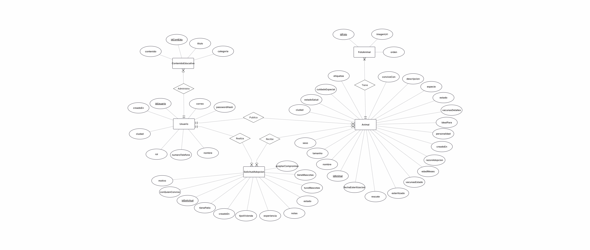

# Huellas al Hogar - `backend`

Esta rama contiene el servidor desarrollado con **Node.js + Express** y la base de datos en **PostgreSQL**. Entrega una API REST con autenticación **JWT**, control de acceso por roles (administrador, rescatista y adoptante), subida de fotografías y la documentación de las pruebas realizadas. La interfaz que consume esta API está en la rama `frontend`.

## Contenido de esta rama

- `src/`: código del servidor (rutas, controladores, middleware y configuración).
- `database/`: script de la base de datos (`schema.sql`), cuentas de prueba (`seed.sql`) y migraciones.
- `docs/`: modelos de base de datos, documentación de la API y evidencias de pruebas.

## Integrantes

- Alonso Troncoso
- Ricardo Vergara
- Claudio Vergara
- Benjamin Brito

## EP 2.1 — Servidor backend

El backend está desarrollado con Node.js y Express. El punto de entrada del servidor es `src/server.js`. La API utiliza PostgreSQL y escucha en el puerto definido por la variable `PORT`; si no se configura, utiliza el puerto `3000`.

El servidor configura CORS, procesa solicitudes JSON, publica las imágenes almacenadas en `uploads/` y conecta las rutas de animales, solicitudes de adopción, contenidos educativos, autenticación y usuarios. También incluye un manejador de errores inesperados.

Para comprobar el estado del servidor se puede consultar `GET /api/health`. Para comprobar además la conexión con PostgreSQL, se puede consultar `GET /api/health/database`.


# Modelo de base de datos (EP 2.2)
El sistema utiliza una base de datos relacional implementada en PostgreSQL.

### 1. Diagramas de diseño
A continuación se presentan el Modelo Entidad-Relación y el Esquema Relacional del sitio web:

### Modelo Entidad-Relación (MER)


### Esquema Relacional (Modelo Lógico)


### 2. Estructura de Tablas y Relaciones
- **usuarios**: Almacena las cuentas registradas con sus credenciales encriptadas (`password_hash`), sus roles (`ADMIN`, `RESCATISTA`, `ADOPTANTE`) y datos de contacto como la `ciudad`.
- **animales**: Guarda la información detallada de las mascotas en adopción (datos de salud, esterilización, tipo de rescate, rasgos de personalidad, etiquetas de compatibilidad y ciudad). Mantiene una relación con la tabla `usuarios` mediante `usuario_id`.
- **foto_animales**: Almacena la galería de imágenes asociadas a cada mascota (con `imagen_url` y `orden` correlativo para gestionar un límite de hasta 5 fotos por animal). Se relaciona directamente con `animales` a través de `animal_id`.
- **solicitudes_adopcion**: Entidad asociativa que conecta a un adoptante (`usuario_id`) con un animal (`animal_id`). Almacena los datos completos del formulario de postulación (tipo de vivienda, patio, experiencia previa, convivencia, motivo de adopción y los datos de contacto `telefono` y `ciudad`) y realiza el seguimiento del estado de la solicitud (`PENDIENTE`, `APROBADA`, `RECHAZADA`) junto con notas internas de administración.
- **contenidos_educativos**: Publicaciones y artículos informativos creados por usuarios con permisos (`usuario_id`).

Se configuraron las claves primarias, claves foráneas y restricciones para asegurar la consistencia de los datos entre tablas, como la relación de un animal con sus fotografías o con sus solicitudes de adopción.

Se generó y almacenó el archivo .sql en la rama backend del repositorio, el cual contiene la estructura completa para replicar la base de datos localmente.

Quien ya tenía la base creada antes de agregar los datos de contacto a las solicitudes debe ejecutar además `database/migracion-001-contacto-solicitud.sql`.

# Configuración e Instalación Local
### 1. Requisitos Previos
* Node.js v18+ 
* PostgreSQL v14+

### 2. Creación de la Base de Datos
Abre PostgreSQL y crea la base de datos:
```bash
CREATE DATABASE "huellas-al-hogar";
```
Luego, para crear la estructura completa de la base de datos (tablas, ENUMs y relaciones), ejecuta el script DDL ubicado en la carpeta `database`, el que se llama `schema.sql`; lo anterior creará las tablas con sus respectivos atributos.

```bash
psql -U postgres -d huellas-al-hogar -f database/schema.sql
```

### 3. Cuentas de prueba
Para poder probar la plataforma con los tres roles, ejecuta también el archivo `seed.sql`, ubicado en la carpeta `database`, que crea tres cuentas de prueba:

```bash
psql -U postgres -d huellas-al-hogar -f database/seed.sql
```

| Rol | Correo | Contraseña |
|---|---|---|
| Administrador | `admin@huellas.test` | `Admin1234` |
| Rescatista | `rescatista@huellas.test` | `Rescata1234` |
| Adoptante | `adoptante@huellas.test` | `Adopta1234` |

También se pueden crear con `npm run seed` (una vez configurado el archivo .env).

Son solo para prueba local para la evaluación, en un ambiente real son un problema de seguridad

### 4. Configuración del archivo .env
El repositorio incluye una plantilla llamada `.env.example`; debes copiarla con el nombre `.env` (en Windows: `copy .env.example .env`) y completar tus valores.
```
PGHOST=localhost
PGPORT=5432
PGDATABASE=huellas-al-hogar
PGUSER=postgres
PGPASSWORD= (la contraseña que usas para acceder a postgres)
JWT_SECRET=cambia-esta-clave-por-una-de-al-menos-32-caracteres
JWT_EXPIRES_IN=8h
```
Debes reemplazar los valores de PGDATABASE (si usaste otro nombre) y PGPASSWORD para que el .env funcione. El JWT_SECRET tiene una validación de 32 caracteres o más; si es más corto, el inicio de sesión y el registro no funcionarán.

### 5. Instalación de dependencias
```bash
npm install
npm start
```
Estos comandos se ejecutan dentro de la carpeta del backend (es decir, en la ruta donde se encuentra el archivo package.json). Caso contrario, arrojará error porque no halla qué instalar ni qué ejecutar. El servidor queda disponible en `http://localhost:3000`.

## EP 2.3 — API REST

La API ofrece operaciones para consultar y administrar animales, solicitudes de adopción y contenidos educativos. Las rutas protegidas requieren el encabezado `Authorization: Bearer <token>` (o en el caso de utilizar la herramienta de postman, incluir el token en el apartado de authorization). La documentación completa de cada endpoint está en `docs/api/API.md`.

### Formato de respuesta

Las respuestas correctas se envían en JSON, con información dentro de `data` cuando corresponde:

```json
{
  "success": true,
  "message": "Operación realizada correctamente",
  "data": {}
}
```

Las respuestas con error usan este formato:

```json
{
  "success": false,
  "error": {
    "message": "Descripción del error"
  }
}
```

### Animales

En todas las rutas que utilizan ":id", este pertenece al id del animal, la solicitud o del contenido educativo pertinente, estos se manejan principalmente con un int generado.

| Método | Ruta | Acceso | Descripción |
|---|---|---|---|
| GET | `/api/animales` | Público | Lista los animales en adopción y en proceso. |
| GET | `/api/animales/:id` | Público; token opcional | Obtiene el detalle. Un animal adoptado solo es visible para su dueño o un ADMIN. |
| GET | `/api/animales/mios` | RESCATISTA o ADMIN | Lista las publicaciones del usuario. ADMIN puede usar `?todos=true` para ver todas. |
| POST | `/api/animales` | RESCATISTA o ADMIN | Crea un animal y sus fotos. |
| PATCH | `/api/animales/:id` | Dueño RESCATISTA o ADMIN | Actualiza los datos y/o las fotos. |
| DELETE | `/api/animales/:id` | Dueño RESCATISTA o ADMIN | Elimina el animal y sus fotos. |

Para crear un animal, enviar `multipart/form-data` con los campos del animal definidos en `database/schema.sql` y entre una y cinco fotos en el campo `fotos`. Se permiten imágenes JPG, PNG o WebP de hasta 5 MB cada una. El usuario asociado se obtiene del token que se mencionó al comienzo. El estado inicial siempre es "en adopción" y lo decide el servidor.

Los campos de lista (`ideal_para`, `convive_con` y `etiquetas`) se pueden enviar como listas separadas por comas cuando se use `multipart/form-data`.

En una edición, `fotos_conservar` puede contener los IDs de las fotos existentes que se mantendrán, separados por comas. Los archivos nuevos se envían en el campo `fotos`; el resultado debe quedar con una a cinco fotos.

El estado `EN_TRATAMIENTO` de la base de datos se muestra en la interfaz como "En proceso".

### Solicitudes de adopción

| Método | Ruta | Acceso | Descripción |
|---|---|---|---|
| GET | `/api/solicitudes` | Token requerido | ADOPTANTE ve las propias; RESCATISTA ve las recibidas por sus animales; ADMIN ve todas. Incluye los datos del postulante y del animal. |
| POST | `/api/solicitudes` | ADOPTANTE o RESCATISTA | Crea una solicitud para un animal disponible. No permite solicitar un animal propio. |
| GET | `/api/solicitudes/:id` | Token requerido | Obtiene una solicitud si pertenece al usuario, al dueño del animal o si quien consulta es ADMIN. |
| PATCH | `/api/solicitudes/:id` | RESCATISTA dueño del animal o ADMIN | Actualiza el estado de la solicitud según las transiciones permitidas. Al aprobarla, el animal pasa a "en proceso". |
| DELETE | `/api/solicitudes/:id` | ADMIN | Elimina una solicitud. |

Ejemplo de cuerpo para `POST /api/solicitudes`:

```json
{
  "animal_id": 1,
  "tipo_vivienda": "Casa",
  "tiene_patio": true,
  "con_quien_convive": "familiares tipo con niños de 3-4 años",
  "tuvo_mascotas": true,
  "tiene_mascotas": false,
  "experiencia": "He cuidado perros anteriormente",
  "motivo": "Quiero un animal de acompañamiento para mis hijos",
  "acepta_compromiso": true,
  "telefono": "+56912345678",
  "ciudad": "Valparaíso"
}
```

Se puede usar `?mias=true` en `GET /api/solicitudes` para consultar las solicitudes enviadas por el usuario autenticado en el caso de querer revisar las consultas de este usuario en especifico.

### Contenidos educativos

| Método | Ruta | Acceso | Descripción |
|---|---|---|---|
| GET | `/api/contenidos-educativos` | Público | Lista contenidos; permite filtrar por categoría. |
| GET | `/api/contenidos-educativos/:id` | Público | Obtiene un contenido por su ID. |
| POST | `/api/contenidos-educativos` | ADMIN | Crea un contenido. |
| PATCH | `/api/contenidos-educativos/:id` | ADMIN | Actualiza un contenido. |
| DELETE | `/api/contenidos-educativos/:id` | ADMIN | Elimina un contenido. |

Ejemplo de cuerpo para crear o actualizar contenido:

```json
{
  "titulo": "Cuidados básicos",
  "categoria": "Tenencia responsable",
  "contenido": "Proporciona agua limpia, alimentación adecuada y controles veterinarios."
}
```

### Rutas relacionadas con autenticación y usuarios

Estas rutas apoyan el funcionamiento de la API y la gestión de roles, son rutas que no pertenecen a una función de la página pero son necesarias para el trabajo de administradores o de uso logico publico como son los "login":

| Método | Ruta | Acceso | Descripción |
|---|---|---|---|
| POST | `/api/auth/registro` | Público | Registra una cuenta con rol ADOPTANTE. |
| POST | `/api/auth/login` | Público | Inicia sesión y entrega un token JWT. |
| POST | `/api/auth/renovar` | Token requerido | Renueva la sesión y devuelve el rol vigente. |
| GET | `/api/usuarios` | ADMIN | Lista usuarios; acepta el filtro opcional `?q=texto`. |
| PATCH | `/api/usuarios/:id/rol` | ADMIN | Cambia el rol de otro usuario. |

### Códigos HTTP

Todos estos codigos son utilizados y enviados por la página al momento de un error, cada uno separado por su razón especifica

- `200`: consulta o modificación realizada correctamente.
- `201`: recurso creado.
- `400`: datos inválidos.
- `401`: falta un token válido o la sesión expiró.
- `403`: el usuario no tiene el rol o permiso necesario.
- `404`: recurso no encontrado.
- `409`: conflicto con el estado actual de los datos.
- `413`: archivo demasiado grande.
- `429`: demasiados intentos de inicio de sesión o registro.
- `500`: error inesperado del servidor.

# Consumo de la API REST desde el frontend (EP 2.4)
En esta fase se integró la interfaz gráfica interactiva con los servicios del servidor para operar con los datos persistentes. Esto se puede evidenciar en los siguientes puntos:
- **Conexión Frontend-Backend**: Se estableció la comunicación asíncrona desde la aplicación desarrollada en Ionic con React hacia los endpoints del servidor Node.js.
- **Peticiones HTTP y Manejo de Errores**: Se configuró el procesamiento de las solicitudes a la API utilizando interceptores, implementando un manejo adecuado de las respuestas y la captura de excepciones. Los errores del servidor se convierten en un mensaje para el usuario desde un solo lugar (`apiError`) y las peticiones tienen un tiempo máximo de espera.
- **Gestión de Sesiones (JWT)**: Se implementó la administración del Json Web Token (JWT) en el cliente, asegurando su almacenamiento y envío en las peticiones para autorizar el acceso a recursos protegidos.
- **Envío de Datos Complejos (Multipart/FormData)**: Se implementó el empaquetado de datos a través de FormData desde el formulario tipo wizard en React, permitiendo enviar texto y archivos multimedia (imágenes) de forma simultánea hacia el endpoint de publicación.
- **Gestión de Flujos Basada en Roles**: El consumo de la API se vinculó a la protección de rutas del frontend. La interfaz ahora restringe o habilita el acceso a los formularios de creación evaluando el rol del usuario (ej. RESCATISTA) contenido en el payload del JWT

# Autenticación con JWT (EP 2.5)
La plataforma implementa autenticación con JSON Web Tokens:
- **Registro e inicio de sesión**: los endpoints `POST /api/auth/registro` y `POST /api/auth/login` están conectados a los formularios del frontend. Toda cuenta nueva se crea con el rol ADOPTANTE.
- **Generación y validación del JWT**: el token se firma con `JWT_SECRET` e incluye el id y el rol del usuario. El middleware `verificarToken` lo valida en cada ruta protegida. Dura lo indicado en `JWT_EXPIRES_IN`, o 30 días si el usuario marca "Mantener sesión iniciada". `POST /api/auth/renovar` entrega un token nuevo con el rol vigente.
- **Rutas protegidas en el frontend**: el componente `ProtectedRoute` redirige a `/login` si no hay sesión (y devuelve al usuario a donde estaba al iniciar sesión) y a `/inicio` si el rol no corresponde.
- **Diferenciación por roles**: el middleware `permitirRoles` restringe cada endpoint a los roles ADMIN, RESCATISTA y/o ADOPTANTE. Un rescatista solo puede modificar sus propias publicaciones. El administrador asigna el rol de rescatista desde el panel de administración.

# Validación de usuarios y manejo de sesiones (EP 2.6)
- **Validación de inputs**: cada endpoint valida tipos, largos, valores permitidos y campos desconocidos antes de tocar la base de datos, y responde 400 indicando los campos inválidos. El frontend valida los formularios antes de enviarlos.
- **Hash de contraseñas con bcrypt**: las contraseñas se guardan con bcrypt con factor de costo 12 y nunca se devuelven en las respuestas.
- **Manejo seguro de credenciales**: las credenciales y la clave del JWT se leen desde variables de entorno (`.env`, que no se sube a git; solo se versiona `.env.example`). El servidor rechaza firmar tokens si `JWT_SECRET` falta o tiene menos de 32 caracteres. El inicio de sesión y el registro tienen un límite de intentos por IP (respuesta 429).
- **Protección básica contra inyección SQL**: todas las consultas usan parámetros (`$1`, `$2`, ...) del paquete `pg`; ningún dato del usuario se concatena en el SQL.

# Pruebas funcionales (EP 2.7)
- **Pruebas en Postman**: la colección `docs/api/Huellas-al-Hogar.postman_collection.json` contiene 68 peticiones con pruebas automáticas que verifican el código HTTP y la estructura JSON de cada respuesta. Cubre autenticación, roles, animales, solicitudes, contenidos educativos, usuarios y pruebas de seguridad (token inválido, inyección SQL y rutas protegidas). Para ejecutarla, importarla en Postman y usar "Run collection" (las instrucciones están en `docs/evidencias/README.md`).
- **Documentación de endpoints**: `docs/api/API.md` describe cada endpoint con su método, ruta, rol requerido, cuerpo y respuestas posibles.
- **Evidencia de pruebas**: las capturas están en `docs/evidencias/` y el video del flujo completo de la plataforma está en el siguiente enlace: _(pegar enlace de Google Drive)_.

## ¿Cómo ejecutar este proyecto?
Sigue los siguientes pasos:
1) Crear la base de datos en postgres ejecutando los scripts `schema.sql` y `seed.sql`.
2) Configurar el archivo .env; este paso ya está documentado.
3) Abre la carpeta del Backend en tu editor de codigo (como Visual Studio Code o el que uses) y en la terminal ejecuta:
   ```
   npm install
   npm start
   ```
4) Sin cerrar la carpeta del backend, ahora abre la carpeta del frontend en tu editor de codigo y en la terminal ejecuta:
   ```
   npm install
   npm run dev
   ```
_En resumen, debes abrir dos veces el editor de codigo (una para el backend y otra para el frontend) para que la página pueda funcionar y para que el backend interactúe con el frontend y viceversa._