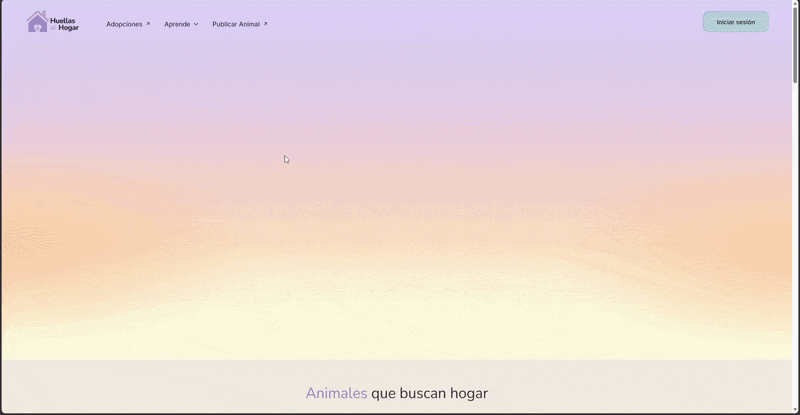

# Huellas al Hogar - `frontend`

<p align="center">
  
</p>

Esta rama contiene la interfaz de usuario desarrollada en **Ionic + React + TypeScript**, junto con la documentación de los requerimientos funcionales y no funcionales del proyecto.

## Integrantes

- Alonso Troncoso
- Ricardo Vergara
- Claudio Vergara
- Benjamin Brito

## Estructura del proyecto

```text
frontend/
├── src/
│   ├── pages/         # Vistas principales (AdoptionsPage, AdoptionDetailPage, AdoptionRequestPage, etc.)
│   ├── components/    # Componentes reutilizables (AdoptionCard, Navbar, Footer, etc.)
│   ├── contexts/      # Estado compartido (sesión)
│   ├── routes/        # Definición de rutas públicas y protegidas
│   ├── services/      # Llamadas a la API (axios)
│   └── theme/         # Variables y estilos globales
├── public/
└── README.md
```

## Roles del sistema

- **Adoptante:** rol por defecto al registrarse. Envía solicitudes de adopción y consulta su estado.
- **Rescatista:** publica animales, gestiona sus publicaciones, revisa solicitudes y cambia el estado de sus animales. El rol lo asigna un administrador.
- **Administrador:** gestiona usuarios, asigna el rol de rescatista, modera publicaciones y administra contenido educativo.

> El usuario no registrado es un estado de acceso, no un rol. Puede explorar animales y contenido educativo, pero debe iniciar sesión para solicitar una adopción.

## Requerimientos funcionales (RF)

| **ID** | **Rol** | **Nombre** | **Descripción** |
| --- | --- | --- | --- |
| **RF-01** | Rescatista | Publicar animal | Permite crear publicaciones con fotografías y datos del animal, como especie, edad, tamaño, salud, cuidados especiales, comportamiento y antecedentes relevantes. |
| **RF-02** | Todos | Explorar animales | Permite visualizar la lista de animales, aplicar filtros por especie, edad, tamaño, sexo y ubicación, además de buscar por nombre. |
| **RF-03** | Adoptante | Solicitud de adopción | Permite completar y enviar una solicitud formal asociada al animal seleccionado. |
| **RF-04** | Rescatista | Revisar solicitudes | Permite visualizar y revisar las solicitudes recibidas para sus publicaciones. |
| **RF-05** | Rescatista | Cambiar estado | Permite modificar el estado de un animal a **En proceso** o **Adoptado**. |
| **RF-06** | Administrador | Gestión de contenido educativo | Permite crear, editar o eliminar contenido sobre tenencia responsable y consecuencias del abandono. |
| **RF-07** | Administrador | Gestión y moderación | Permite visualizar usuarios, asignar el rol de rescatista, moderar usuarios y eliminar publicaciones que incumplan las normas. |
| **RF-08** | Adoptante | Historial de solicitudes | Permite consultar las solicitudes propias y su estado: pendiente, aprobada o rechazada. |
| **RF-09** | Rescatista | Gestión de publicaciones | Permite editar o eliminar las publicaciones propias. |

## Requerimientos no funcionales (RNF)

| **ID** | **Categoría** | **Descripción** |
| --- | --- | --- |
| **RNF-UX-01** | Usabilidad | La interfaz debe funcionar sin elementos principales cortados, superpuestos o inaccesibles en anchos de 360, 390, 768, 1024 y 1440 px. |
| **RNF-UX-02** | Usabilidad | El 100 % de los campos obligatorios inválidos de formularios críticos debe mostrar un mensaje de error antes de permitir el envío. |
| **RNF-UX-03** | Usabilidad | Al iniciar sesión desde una solicitud de adopción, el sistema debe conservar el animal seleccionado y retornar al mismo flujo en el 100 % de las pruebas. |
| **RNF-UX-04** | Usabilidad | El 100 % de las vistas secundarias definidas en el prototipo debe disponer de una acción visible para regresar al nivel anterior. |
| **RNF-SEG-01** | Seguridad | Las contraseñas no deben almacenarse en texto plano; el backend deberá utilizar Argon2id o bcrypt con factor de costo igual o superior a 12. |
| **RNF-SEG-02** | Seguridad | El 100 % de las comunicaciones con datos personales deberá utilizar HTTPS con TLS 1.2 o superior en ambiente desplegado. |
| **RNF-SEG-03** | Seguridad | El 100 % de las solicitudes no autorizadas sobre recursos protegidos deberá ser rechazado con código 401 o 403, según corresponda. |
| **RNF-REN-01** | Rendimiento | Con conexión equivalente a 4G y una carga inicial de hasta 24 animales, el contenido principal del catálogo deberá estar disponible en un máximo de 3 segundos. |
| **RNF-COM-01** | Compatibilidad | La aplicación deberá funcionar en la versión estable actual y la inmediatamente anterior de Chrome, Safari, Firefox y Edge sin errores críticos en los flujos principales. |

## EP 1.4 Arquitectura de navegación

### Rutas principales y secundarias

| **Ruta** | **Vista** | **Acceso** | **Descripción** |
| --- | --- | --- | --- |
| `/inicio` | Inicio | Pública | Landing principal |
| `/adopciones` | Adopciones | Pública | Catálogo de animales |
| `/adopciones/:animalId` | Perfil del animal | Pública | Detalle del animal seleccionado |
| `/adopciones/:animalId/solicitar` | Solicitud de adopción | Privada (usuario autenticado) | Formulario de solicitud |
| `/educacion` | Educación | Pública | Contenido educativo |
| `/login`, `/registro` | Login y registro | Pública | Inicio de sesión y creación de cuenta |
| `/perfil` | Perfil | Protegida | Perfil del usuario autenticado |
| `/publicar` | Publicar animal | Rescatista / Administrador | Formulario de publicación. El resto de usuarios ve los requisitos para ser rescatista |

### Jerarquía de vistas

```text
/inicio
├── /adopciones
│   └── /adopciones/:animalId
│       └── /adopciones/:animalId/solicitar
├── /educacion
├── /login
├── /perfil
└── /publicar
```

### Diferenciación de acceso por rol

| **Segmento** | **Acceso** | **Comportamiento** |
| --- | --- | --- |
| `/inicio`, `/adopciones`, `/adopciones/:animalId`, `/educacion`, `/login` | Público | Puede acceder un usuario sin autenticación. |
| `/adopciones/:animalId/solicitar`, `/perfil` | Usuario autenticado | Sin sesión, redirige a `/login` y, al iniciar sesión, devuelve a la ruta de origen. |
| `/publicar` | Rescatista / Administrador | Estos roles ven el formulario; el resto ve los requisitos para ser rescatista. |

### Flujo de tareas principales (task flows)

**Task flow 1 — Solicitar una adopción:** `/inicio` → `/adopciones` → seleccionar animal → `/adopciones/:animalId` → solicitar adopción → si no existe sesión activa, iniciar sesión → retomar solicitud → completar formulario → enviar.

**Task flow 2 — Publicar un animal:** iniciar sesión → `/publicar` → completar información básica → características → salud y cuidados → fotos y descripción → revisión → publicar.

### Puntos críticos de interacción

- **Solicitud de adopción:** los campos obligatorios deben estar identificados y mostrar errores de validación comprensibles.
- **Inicio de sesión durante la adopción:** el usuario debe poder autenticarse sin perder el animal seleccionado.
- **Publicación de animal:** el rescatista debe identificar claramente la información obligatoria y avanzar por las etapas del formulario.
- **Estados del animal:** los estados **En adopción**, **En proceso** y **Adoptado** deben mostrarse de forma consistente.
- **Filtros del catálogo:** el usuario debe poder identificar claramente qué filtros se encuentran activos.

### Coherencia entre dispositivos

- En **web**, la navegación principal utiliza una barra superior con acceso a Adopciones, Aprende, Publicar Animal e Inicio de sesión / Perfil.
- En **móvil**, la navegación se adapta mediante un menú desplegable; la solicitud de adopción se divide en pasos y los filtros se abren en una ventana.
- Las grillas, formularios, filtros y galerías ajustan su distribución al ancho disponible manteniendo la jerarquía visual.

### Justificación técnica de las decisiones

- **React Router:** gestiona el enrutamiento declarativo entre las distintas vistas.
- **Rutas protegidas:** permiten restringir las funcionalidades según autenticación y rol, conservando la ruta de origen.
- **Estructura modular:** separar `pages`, `components`, `services`, `contexts`, `routes` y `theme` facilita mantener y ampliar el frontend. La capa `services` conecta con la API del backend.

## Ejecución local

Requiere Node.js 20 o superior y, para ver animales reales, el backend corriendo en `http://localhost:3000`.

```bash
npm install
npm run dev
```