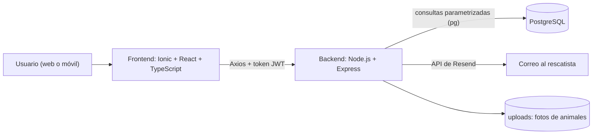

# Huellas al Hogar — Entrega Final

> **Ingeniería Web y Móvil · Entrega final.** Documentación global del proyecto integrado (frontend, backend, base de datos, servicio externo y despliegue). El detalle técnico de cada parte está en el [README del frontend](../README.md) y en el [README del backend](https://github.com/Wavffle/Huellas-al-Hogar/blob/backend/README.md).
>
> **Etiquetas de la entrega:** `v1.0.0` (rama `frontend`) y `v1.0.0-backend` (rama `backend`). Las ramas `EP1 Documentacion` y `EP2 Documentacion` conservan la documentación de las entregas parciales.

## Contenido

1. [Cumplimiento de la rúbrica](#1-cumplimiento-de-la-rúbrica)
2. [Problema y solución](#2-problema-y-solución)
3. [Equipo y responsabilidades](#3-equipo-y-responsabilidades)
4. [Arquitectura general](#4-arquitectura-general)
5. [Progreso EP1 → EP2 → EF](#5-progreso-ep1--ep2--ef)
6. [Trazabilidad de requerimientos](#6-trazabilidad-de-requerimientos)
7. [Escenarios de demostración](#7-escenarios-de-demostración)
8. [Seguridad (EF3)](#8-seguridad-ef3)
9. [Optimización de rendimiento y consultas (EF2 y EF4)](#9-optimización-de-rendimiento-y-consultas-ef2-y-ef4)
10. [Almacenamiento local y notificaciones (EF1)](#10-almacenamiento-local-y-notificaciones-ef1)
11. [Servicio externo: correo con Resend (EF5)](#11-servicio-externo-correo-con-resend-ef5)
12. [Despliegue con Docker (EF6)](#12-despliegue-con-docker-ef6)
13. [Pruebas y evidencias](#13-pruebas-y-evidencias)
14. [Limitaciones conocidas](#14-limitaciones-conocidas)
15. [Etiquetas de la entrega](#15-etiquetas-de-la-entrega)

---

## 1. Cumplimiento de la rúbrica

| Criterio | Pts | Qué se hizo | Sección |
|---|---|---|---|
| **EF1** Funcionalidades completas | 20 | CRUD de animales, solicitudes, contenido educativo y usuarios; autenticación JWT con tres roles; almacenamiento local (sesión y filtros del catálogo); notificaciones (correo, contador en el menú y avisos en pantalla). | [10](#10-almacenamiento-local-y-notificaciones-ef1) |
| **EF2** UI/UX y rendimiento | 15 | Carga diferida de páginas, separación de librerías en archivos propios, imágenes recomprimidas, estados de carga y error con reintento. | [9](#9-optimización-de-rendimiento-y-consultas-ef2-y-ef4) |
| **EF3** Seguridad avanzada | 15 | Helmet, CORS restrictivo, bcrypt, JWT con rol vigente, consultas parametrizadas, validación de imágenes por contenido, escape de HTML, límite de intentos. | [8](#8-seguridad-ef3) |
| **EF4** Consultas | 10 | Nueve índices (incluidos índices sobre `LOWER(...)`), filtros resueltos en SQL, respuestas con columnas explícitas. | [9](#9-optimización-de-rendimiento-y-consultas-ef2-y-ef4) |
| **EF5** Servicio externo | 10 | Correo de aviso al rescatista con la API de Resend. | [11](#11-servicio-externo-correo-con-resend-ef5) |
| **EF6** Docker | 15 | **En preparación.** Se completa cuando los archivos Docker estén en el repositorio. | [12](#12-despliegue-con-docker-ef6) |
| Presentación | 15 | Demostración por escenarios sobre la aplicación funcionando. | [7](#7-escenarios-de-demostración) |

---

## 2. Problema y solución

**Huellas al Hogar** es una plataforma web y móvil que conecta a rescatistas con personas que quieren adoptar animales, y que promueve la tenencia responsable mediante contenido educativo.

- **Rescatistas** publican animales con fotografías y datos de salud y comportamiento, reciben solicitudes formales y gestionan el estado de cada animal.
- **Adoptantes** exploran el catálogo, envían una solicitud de adopción y consultan su estado.
- **Administradores** asignan el rol de rescatista, moderan publicaciones y administran el contenido educativo.

La justificación completa del problema, los usuarios objetivo y las proto-personas están en la documentación de la entrega parcial 1 (rama `EP1 Documentacion`).

---

## 3. Equipo y responsabilidades

| Integrante | Responsabilidades |
|---|---|
| Alonso Troncoso |  |
| Ricardo Vergara |  |
| Claudio Vergara |  |
| Benjamin Brito |  |

---

## 4. Arquitectura general



| Capa | Tecnologías | Dónde está |
|---|---|---|
| Frontend | Ionic 8, React 18, TypeScript, Vite 5, React Router v5, Axios con interceptores, Vitest | Rama `frontend` |
| Backend | Node.js, Express 5, `pg` (sin ORM), JWT, bcrypt, multer, helmet, cors, resend | Rama `backend` |
| Base de datos | PostgreSQL (`database/schema.sql`, re-ejecutable) | Rama `backend` |
| Servicio externo | Resend (correo transaccional) | Backend |
| Despliegue | Docker y docker-compose | [Pendiente](#12-despliegue-con-docker-ef6) |

**Backend por capas:** rutas → middleware (autenticación, roles, subida de archivos, límite de intentos) → controladores (solo traducen HTTP) → servicios (lógica de negocio y SQL) → PostgreSQL. Los errores esperados se lanzan con `ErrorHttp` y un manejador central los convierte en respuesta JSON.

**Modelo de datos:** `usuarios`, `animales`, `foto_animales`, `solicitudes_adopcion`, `contenidos_educativos` y `bloques_contenido`. Los diagramas MER y relacional están en el README del backend.

**Roles:** `ADMIN`, `RESCATISTA` y `ADOPTANTE`. Toda cuenta nueva es ADOPTANTE; un administrador asigna el rol de rescatista.

---

## 5. Progreso EP1 → EP2 → EF

### Entrega parcial 1: diseño y estructura

Requerimientos funcionales y no funcionales, justificación del problema y proto-personas, prototipo en Figma, arquitectura de navegación y frontend en Ionic + React con rutas públicas y protegidas. Documentación en la rama `EP1 Documentacion`.

### Entrega parcial 2: integración y autenticación

Backend con Express, base de datos PostgreSQL, API REST con CRUD, JWT con roles, bcrypt, validaciones y pruebas en Postman. Documentación en la rama `EP2 Documentacion`.

### Observaciones de la entrega parcial 2 (corregidas)

| Criterio | Qué se corrigió |
|---|---|
| EP 2.1 Servidor | Nueva capa `services/` (`animales`, `solicitudes`) con validaciones, SQL y transacciones; los controladores pasaron de 513 a 66 líneas (animales) y de 617 a 54 (solicitudes). Nuevas utilidades `errores`, `validaciones` y `transaccion`. |
| EP 2.2 Base de datos | `schema.sql` re-ejecutable (probado en base nueva y antigua); restricción `UNIQUE (usuario_id, animal_id)` en solicitudes; `tamanho` normalizado a `PEQUENO`, `MEDIANO` o `GRANDE`. |
| EP 2.3 API REST | Filtros `?especie=`, `?ciudad=` y `?tamanho=` en `GET /api/animales`, combinables y validados. |
| EP 2.4 JWT y roles | El rol vigente se lee de la base de datos en cada petición; el frontend renueva la sesión ante un 403 para actualizar el rol. |
| EP 2.5 Seguridad | `JWT_SECRET` rotado y `.env` fuera del repositorio; validación de imágenes por contenido; `npm audit` del backend sin vulnerabilidades. |
| EP 2.6 Integración | Contenido educativo migrado a la API (`bloques_contenido`, 7 secciones, 26 filas); datos estáticos eliminados del frontend; 35 pruebas con Vitest. |
| Documentación y GitHub | READMEs, `API.md` y evidencias actualizados; colección de Postman ampliada de 68 peticiones y 228 pruebas a 80 y 240. |

### Entrega final

| Área | Mejora |
|---|---|
| EF1 | Almacenamiento local de filtros y orden del catálogo; notificaciones por correo, contador de solicitudes pendientes en el menú y avisos en el panel del rescatista. |
| EF2 | Carga diferida de rutas, separación de librerías, imágenes recomprimidas. |
| EF3 | Helmet, CORS restrictivo y escape de HTML en el correo. |
| EF4 | Índices en la base de datos y filtro de pendientes resuelto en el servidor. |
| EF5 | Integración con Resend. |
| EF6 | [En preparación](#12-despliegue-con-docker-ef6). |

---

## 6. Trazabilidad de requerimientos

Los requerimientos RF-01 a RF-09 y RNF están definidos en el [README del frontend](../README.md). RF-10 y RF-11 se incorporan en esta entrega.

### Requerimientos funcionales

| ID | Requerimiento | Frontend | Backend | Verificación |
|---|---|---|---|---|
| RF-01 | Publicar animal | `/publicar` (formulario por pasos) | `POST /api/animales` (multipart, 1 a 5 fotos) | Postman · Escenario 1 |
| RF-02 | Explorar animales | `/adopciones` (filtros por especie, edad, tamaño, sexo, ciudad y nombre) | `GET /api/animales` (filtros `especie`, `ciudad` y `tamanho`) | Postman · Escenario 1 |
| RF-03 | Solicitud de adopción | `/adopciones/:animalId/solicitar` (4 pasos con validación) | `POST /api/solicitudes` | Postman · Escenario 1 |
| RF-04 | Revisar solicitudes | `/panel`, pestaña «Solicitudes recibidas» | `GET /api/solicitudes` (rescatista: las recibidas) | Postman · Escenario 1 |
| RF-05 | Cambiar estado | `/panel`, selector de estado | `PATCH /api/animales/:id` | Postman · Escenario 1 |
| RF-06 | Gestión de contenido educativo | `/admin` | `POST`, `PATCH` y `DELETE /api/contenidos-educativos` (ADMIN) | Postman · Escenario 2 |
| RF-07 | Gestión y moderación | `/admin` | `GET /api/usuarios`, `PATCH /api/usuarios/:id/rol`, `DELETE /api/animales/:id` | Postman · Escenario 2 |
| RF-08 | Historial de solicitudes | `/mis-solicitudes` | `GET /api/solicitudes?mias=true` | Postman · Escenario 1 |
| RF-09 | Gestión de publicaciones | `/publicar/:id/editar` y `/panel` | `PATCH` y `DELETE /api/animales/:id` (dueño o ADMIN) | Postman · Escenario 1 |
| RF-10 | Notificaciones de nuevas solicitudes (nuevo) | Contador en el menú y avisos en el panel | Correo con Resend al crear la solicitud; `GET /api/solicitudes?estado=PENDIENTE` | Escenario 1 |
| RF-11 | Preferencias del catálogo guardadas (nuevo) | Filtros y orden en `localStorage` | — | Escenario 1 |

### Requerimientos no funcionales

| ID | Cómo se cumple | Verificación |
|---|---|---|
| RNF-SEG-01 | bcrypt con costo 12; el hash nunca se devuelve en las respuestas. | Postman (registro e inicio de sesión) |
| RNF-SEG-02 | HTTPS aplica al ambiente desplegado; en local se usa HTTP. Se definirá junto con el despliegue. | Pendiente |
| RNF-SEG-03 | `verificarToken` y `permitirRoles` responden 401 o 403 según el caso. | Postman (401 y 403) · pruebas de `apiClient` |
| RNF-REN-01 | Carga diferida, índices, imágenes recomprimidas y listados con columnas mínimas. | _Medir con la pestaña Network (4G simulada) y anotar el resultado_ |
| RNF-UX-02 | Validación de campos obligatorios en el frontend y respuestas 400 con los campos inválidos en el backend. | Manual · Postman |
| RNF-UX-03 | `ProtectedRoute` conserva la ruta de origen y devuelve al usuario al iniciar sesión. | Manual |
| RNF-UX-01, RNF-UX-04, RNF-COM-01 | Diseño adaptable y navegación de retorno en las vistas secundarias. | Revisión manual |

---

## 7. Escenarios de demostración

La demostración se hace sobre la aplicación funcionando, con las cuentas de prueba del README del backend.

**Preparación:** base de datos creada con `schema.sql`, `seed-contenido.sql` y `seed.sql`; archivo `.env` con `RESEND_API_KEY`; backend y frontend en ejecución; el correo del rescatista debe ser el de la cuenta de Resend (ver [limitaciones](#14-limitaciones-conocidas)).

**Escenario 1 — Del rescate a la adopción** (roles rescatista y adoptante)

1. El rescatista inicia sesión y publica un animal con fotos en `/publicar`.
2. En otra ventana, el adoptante explora `/adopciones`, aplica filtros (que se conservan al recargar), abre el animal y envía la solicitud.
3. Llega el correo al rescatista y, en menos de un minuto, aparece el contador de pendientes en su menú.
4. El rescatista abre «Mi panel», revisa el detalle y aprueba la solicitud: aparece el aviso en pantalla, el animal pasa a «En proceso» y el contador baja.
5. El adoptante consulta el estado en `/mis-solicitudes`.

**Escenario 2 — Administración** (rol administrador)

El administrador asigna el rol de rescatista a una cuenta, modera una publicación y gestiona un artículo educativo. El nuevo rol se aplica sin cerrar sesión, porque el servidor lee el rol vigente de la base.

**Escenario 3 — Seguridad**

Petición sin token (401), con un rol insuficiente (403) y subida de un archivo falso como imagen (400), en Postman o en la aplicación.

**Escenario 4 — Despliegue con Docker:** pendiente ([sección 12](#12-despliegue-con-docker-ef6)).

**Distribución sugerida de los 20 minutos:** problema y arquitectura (4), escenario 1 (8), escenario 2 (3), seguridad y optimización (2) y Docker (3).

---

## 8. Seguridad (EF3)

| Medida | Dónde | Verificación |
|---|---|---|
| Hash de contraseñas con bcrypt (costo 12) | Backend, registro e inicio de sesión | Postman |
| JWT firmado con `JWT_SECRET` (mínimo 32 caracteres), con expiración (8 h o 30 días); el rol vigente se lee de la base en cada petición | Middleware `verificarToken` | Postman · pruebas de `apiClient` |
| Control de acceso por rol y por dueño del recurso | `permitirRoles` y servicios | Postman (403) |
| Validación de entradas: tipos, largos, valores permitidos y campos desconocidos (400 con los campos inválidos) | Servicios | Postman |
| Protección contra inyección SQL: consultas parametrizadas; los nombres de columna de las actualizaciones salen de una lista blanca | Servicios | Postman (prueba de inyección) |
| Protección contra XSS: cabeceras de `helmet`, escape de HTML en el correo y renderizado con React, que escapa el contenido por defecto | `server.js`, `email.service.js`, frontend | Revisión de código |
| CORS restrictivo: solo los orígenes de `CORS_ORIGIN` (por defecto `http://localhost:5173`) y los encabezados `Content-Type` y `Authorization` | `server.js` | Configuración |
| Política `cross-origin` de recursos con `helmet`, para que el frontend cargue las imágenes de `uploads/` | `server.js` | Configuración |
| Límite de intentos en inicio de sesión y registro (429) | Middleware `limitarIntentos` | Postman |
| Subida de imágenes: tipo declarado y primeros bytes del archivo (JPEG, PNG, WebP), máximo 5 MB y de 1 a 5 fotos; si alguna es inválida se descartan todas | Middleware `upload` | Postman (archivo falso) |
| Credenciales fuera del repositorio: `.env` ignorado, `.env.example` con marcadores y `JWT_SECRET` rotado | Repositorio | Revisión |
| Errores inesperados sin detalles internos (mensaje genérico con código 500) | Manejador global | Revisión de código |
| Dependencias: `npm audit` del backend sin vulnerabilidades; en el frontend solo hay avisos en herramientas de desarrollo (`npm audit --omit=dev` da 0) | Ambos | `npm audit` |

---

## 9. Optimización de rendimiento y consultas (EF2 y EF4)

### Frontend (EF2)

| Mejora | Detalle |
|---|---|
| Carga diferida de páginas | Todas las páginas, salvo Inicio, se cargan con `React.lazy` y `Suspense` al entrar a su ruta (`AppRoutes.tsx` y `PublishGate.tsx`). |
| Separación de librerías | `vite.config.ts` genera archivos propios para React e Ionic, que el navegador guarda en caché. |
| Imágenes | Imágenes `.webp` recomprimidas. |
| Estados de carga y error | `PawLoader` y `ContentState` con opción de reintentar. |
| Menos peticiones | El contador del menú pide solo las solicitudes pendientes (`?estado=PENDIENTE`) y se actualiza cada 60 segundos, al volver a la pestaña o tras un cambio en el panel. |

Resultado del build de producción: el código de la aplicación (`index`) pesa 125 kB (43 kB comprimidos), React 169 kB (55 kB) e Ionic 1.166 kB (245 kB). Cada página es un archivo propio de entre 0,4 y 17 kB. Antes de esta entrega todo el código viajaba en un solo archivo. El único archivo por encima de 500 kB es la librería Ionic, de terceros, por lo que se subió el límite del aviso de Vite con un comentario explicativo en `vite.config.ts`.

### Base de datos (EF4)

Índices definidos en la sección 4 de `database/schema.sql`:

| Índice | Columnas | Consulta que acelera |
|---|---|---|
| `idx_animales_usuario_id` | `animales(usuario_id)` | «Mis publicaciones» |
| `idx_animales_estado` | `animales(estado)` | Catálogo público por estado |
| `idx_animales_especie_lower` | `animales(LOWER(especie))` | Filtro `?especie=` sin distinguir mayúsculas |
| `idx_animales_ciudad_lower` | `animales(LOWER(ciudad))` | Filtro `?ciudad=` sin distinguir mayúsculas |
| `idx_animales_tamanho` | `animales(tamanho)` | Filtro `?tamanho=` |
| `idx_foto_animales_animal_orden` | `foto_animales(animal_id, orden)` | Galería y portada de cada animal |
| `idx_solicitudes_animal_estado` | `solicitudes_adopcion(animal_id, estado)` | Solicitudes por animal y conteo de pendientes |
| `idx_solicitudes_estado` | `solicitudes_adopcion(estado)` | Filtro `?estado=` |
| `idx_contenidos_categoria` | `contenidos_educativos(categoria)` | Filtro `?categoria=` |

Los índices de `especie` y `ciudad` son sobre `LOWER(...)` porque la consulta compara `LOWER(columna) = LOWER($1)`; un índice normal no se usaría. Con `SET enable_seqscan = off; EXPLAIN ANALYZE ...` se comprobó que la consulta usa `idx_animales_especie_lower` (Index Scan).

Otras decisiones de consulta: los listados seleccionan columnas explícitas (nunca `SELECT *`), los filtros se aplican en SQL con parámetros, la portada se obtiene con un único `LEFT JOIN`, y las operaciones críticas (crear solicitud, cambiar estado, editar animal) usan transacciones con bloqueo de fila (`FOR UPDATE`).

---

## 10. Almacenamiento local y notificaciones (EF1)

### Almacenamiento local

| Qué se guarda | Dónde | Detalle |
|---|---|---|
| Sesión (token y usuario) | `localStorage` (`AuthContext`) | Se valida el vencimiento del token al abrir la aplicación y se sincroniza entre pestañas. |
| Filtros y orden del catálogo | `localStorage` (`huellas.adopciones.filtros` y `huellas.adopciones.orden`) | Se restauran al volver al catálogo. El texto de búsqueda no se guarda. Los valores guardados se validan antes de usarse. |

### Notificaciones

| Notificación | Para quién | Cómo funciona |
|---|---|---|
| Correo de nueva solicitud | Rescatista | Se envía al crear la solicitud ([sección 11](#11-servicio-externo-correo-con-resend-ef5)). |
| Contador de solicitudes pendientes | Rescatista y administrador | Aparece junto al nombre del usuario y junto a «Mi panel». Se actualiza cada 60 segundos, al volver a la pestaña y tras aprobar o rechazar. |
| Avisos en pantalla (`IonToast`) | Rescatista | Al aprobar o rechazar una solicitud, cambiar el estado de un animal o eliminar una publicación. |
| Confirmación de envío | Adoptante | Pantalla «¡Solicitud enviada!» con acceso a «Mis solicitudes». |

---

## 11. Servicio externo: correo con Resend (EF5)

**Qué hace:** cuando un adoptante envía una solicitud, el backend avisa por correo al rescatista dueño del animal con el nombre del postulante y del animal.

| Aspecto | Detalle |
|---|---|
| Código | `src/services/email.service.js` (`enviarCorreoSolicitud`), llamada desde `crearSolicitud` en `src/services/solicitudes.service.js`. |
| Cuándo se envía | Una vez confirmada la transacción que guarda la solicitud. No se espera su resultado. |
| Configuración | Variable de entorno `RESEND_API_KEY` (ver `.env.example`). La clave no se sube al repositorio. |
| Errores | Un fallo del envío se registra en la consola y no afecta a la solicitud. Si falta la clave, el servidor arranca igual y registra un aviso. |
| Seguridad | Los textos que vienen del usuario se escapan antes de insertarlos en el HTML del correo. |
| Valor para la aplicación | Avisa al rescatista sin que tenga que abrir la plataforma. |

Detalle técnico y variables de entorno: sección «EF 5» del [README del backend](https://github.com/Wavffle/Huellas-al-Hogar/blob/backend/README.md).

---

## 12. Despliegue con Docker (EF6)

> **Estado: pendiente de documentar.** Un integrante del equipo prepara la configuración y esta sección se completa cuando sus archivos estén en el repositorio y probados.

**Lo que debe quedar documentado aquí** (según la rúbrica):

- `Dockerfile` del backend y del frontend.
- `docker-compose.yml` que orquesta frontend, API y base de datos.
- Variables de entorno necesarias (`PG*`, `JWT_SECRET`, `JWT_EXPIRES_IN`, `CORS_ORIGIN`, `RESEND_API_KEY`, `VITE_API_URL`).
- Instrucciones de ejecución y evidencia de que corre en local.

**Decisiones por resolver:**

| Tema | Pregunta |
|---|---|
| Ubicación | Frontend y backend están en ramas distintas: ¿dónde vive el `docker-compose.yml` y cómo se referencian ambos códigos? |
| Base de datos | ¿Cómo se cargan `schema.sql`, `seed-contenido.sql` y `seed.sql` al crear el contenedor? |
| Fotos | ¿La carpeta `uploads/` se conserva en un volumen? |
| Frontend | `VITE_API_URL` se define al construir la imagen: ¿qué dirección usa dentro de Docker? |
| CORS | `CORS_ORIGIN` debe coincidir con el origen desde el que se abre el frontend. |
| Secretos | ¿Cómo se pasan `JWT_SECRET` y `RESEND_API_KEY` sin subirlos al repositorio? |

**Plantilla para completar:**

| Servicio | Imagen o Dockerfile | Puerto | Variables |
|---|---|---|---|
| Base de datos | _Por completar_ | _Por completar_ | _Por completar_ |
| Backend | _Por completar_ | _Por completar_ | _Por completar_ |
| Frontend | _Por completar_ | _Por completar_ | _Por completar_ |

```bash
# Comando de ejecución (por completar)
```

Evidencia de despliegue local: _por completar_.

---

## 13. Pruebas y evidencias

| Prueba | Alcance | Dónde |
|---|---|---|
| Colección de Postman | 80 peticiones y 240 pruebas: autenticación, roles, animales y sus filtros, solicitudes, contenido educativo, usuarios y seguridad | `docs/api/Huellas-al-Hogar.postman_collection.json` (rama `backend`) |
| Documentación de endpoints | Método, ruta, rol, cuerpo y respuestas | `docs/api/API.md` (rama `backend`) |
| Evidencias de Postman | Capturas del resultado y de los casos de error | `docs/evidencias/` (rama `backend`) |
| Pruebas del frontend | 35 pruebas con Vitest del cliente de la API y de la sesión (`npm test`) | Rama `frontend` |
| Compilación | `npm run build` compila sin errores de TypeScript | Rama `frontend` |
| Uso de índices | `EXPLAIN ANALYZE` con `Index Scan using idx_animales_especie_lower` | [Sección 9](#base-de-datos-ef4) |
| Video del flujo completo | Recorrido de la plataforma | Enlace en el README del backend |

---

## 14. Limitaciones conocidas

- **Correo de prueba de Resend:** con el remitente `onboarding@resend.dev`, Resend solo entrega mensajes al correo con el que se creó la cuenta. Para enviar a cualquier rescatista habría que verificar un dominio propio.
- **HTTPS:** aplica al ambiente desplegado; en local se usa HTTP (RNF-SEG-02).
- **Filtros del catálogo:** especie, ciudad y tamaño también existen en la API; edad, sexo y nombre se aplican en el frontend sobre el catálogo cargado, y la paginación del catálogo es del lado del cliente.
- **Tamaño del paquete:** la librería Ionic (1.166 kB, 245 kB comprimidos) supera los 500 kB y no se puede dividir desde el código del proyecto.
- **Texto fijo:** las preguntas frecuentes, «cómo funciona» y «propósito» del inicio siguen como textos de la interfaz y no vienen de la API.

---

## 15. Etiquetas de la entrega

La entrega final se marca con etiquetas (tags) y no con una rama nueva. Como `frontend` y `backend` son ramas independientes, cada una lleva su etiqueta:

| Rama | Etiqueta |
|---|---|
| `frontend` | `v1.0.0` |
| `backend` | `v1.0.0-backend` |

```bash
git tag -a v1.0.0 -m "Entrega Final - Ingeniería Web y Móvil"
git push origin v1.0.0
```