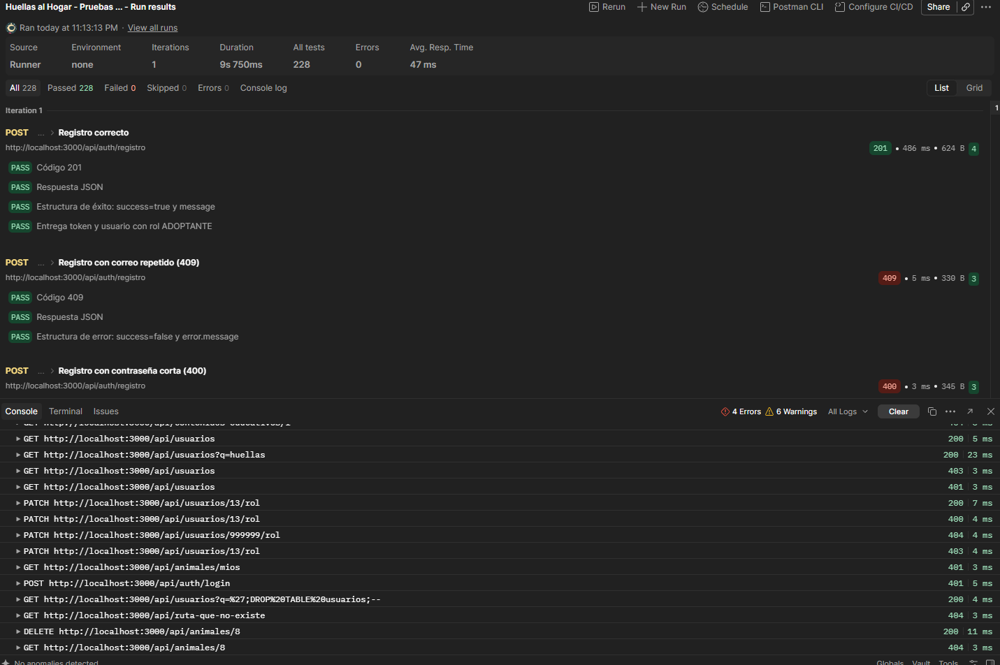
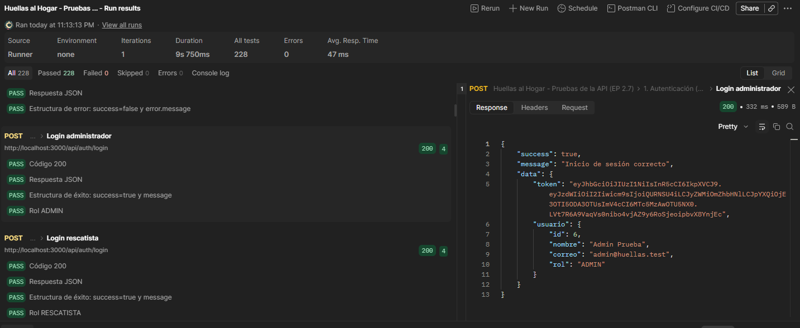
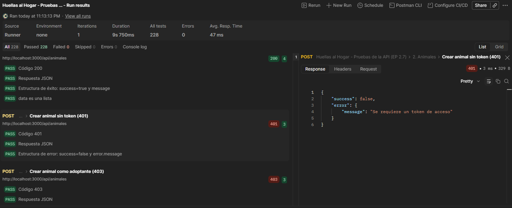
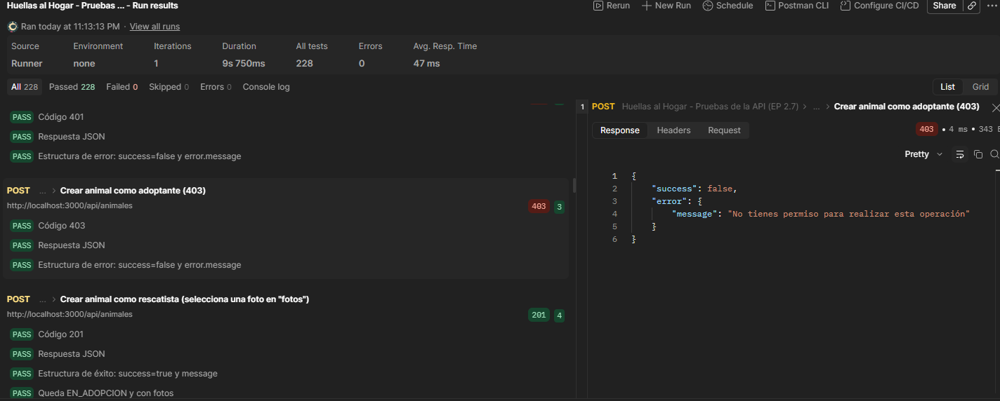
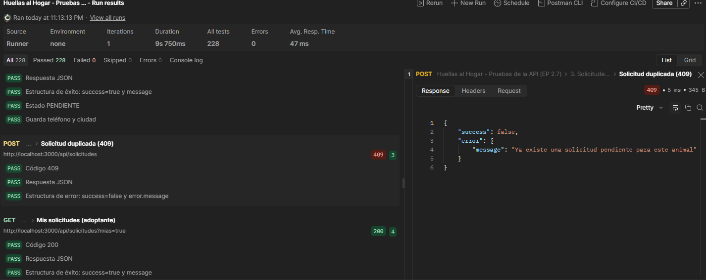
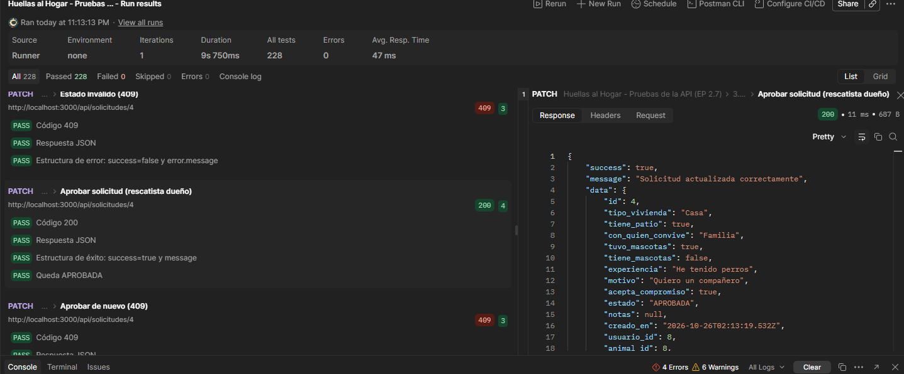
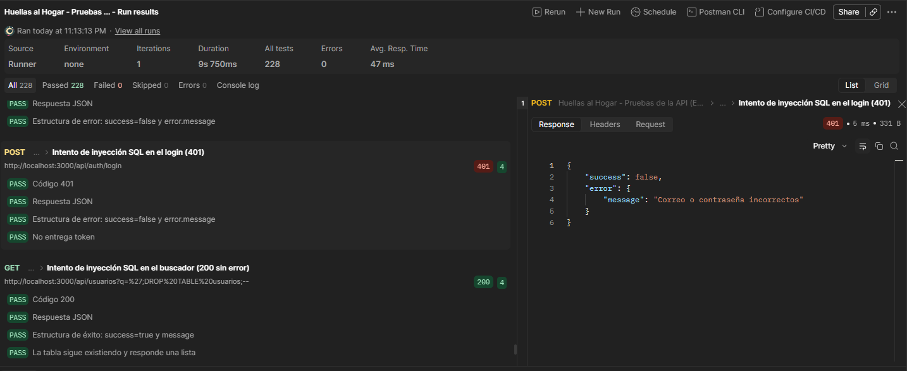

# Evidencias de pruebas (EP 2.7)

Pruebas funcionales realizadas con Postman sobre la API. La colección está en [`../api/`](../api) y contiene 68 peticiones con pruebas automáticas que verifican el código HTTP y la estructura de cada respuesta.

## Resultado de la ejecución completa

## Autenticación y roles

**Inicio de sesión del administrador (200)**

**Petición protegida sin token (401)**

**Un adoptante intenta crear un animal (403)**

## Reglas del negocio

**Solicitud de adopción repetida (409)**

**Aprobar una solicitud deja al animal "En proceso"**

## Seguridad

**Intento de inyección SQL en el login (401)**

## Video del flujo completo

[Ver video en Google Drive](https://drive.google.com/file/d/1iTrnilpy7mvVo4KkJhElS0W45Rq_eQJG/view?usp=sharing)